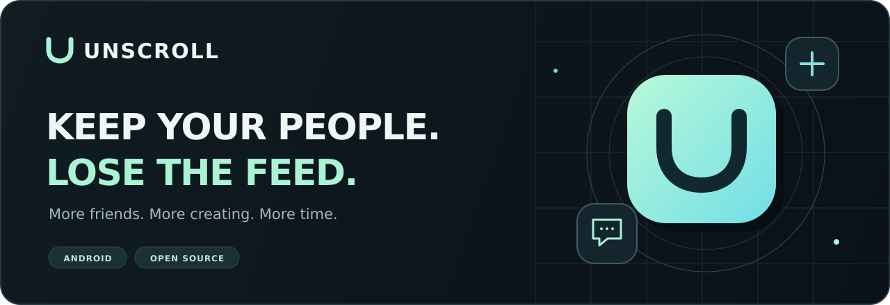

  

<h1 align="center">TikTok without the endless feed</h1>

Message your friends. Publish your work. Get back to your life.

  <b><a href="https://t.me/SayNoToScrolling">Download APK · Telegram →</a></b>

  <a href="https://t.me/SayNoToScrolling">APKs &amp; updates</a> ·
  <a href="docs/INSTALL.md">Installation (RU)</a> ·
  <a href="docs/BUILD.md">Build from source</a> ·
  <a href="README.md">Русский</a>

---

## Open with a purpose

**Unscroll** is an open-source modification project for TikTok on Android. Its goal
is to keep conversations and content creation while removing infinite feeds and
the swipe-to-next-video loop.

Reply to a friend. Watch the video they sent. Publish something of your own.
Then get back to what matters outside the app.

> [!IMPORTANT]
> **Early development.** Patch application to a real TikTok APK and behaviour on a
> device have not been verified. The features below describe the intended product,
> not confirmed functionality. See [compatibility](docs/COMPATIBILITY.md).

## Keep the useful parts

| Keep | Remove |
| --- | --- |
| Direct messages, group chats and streaks | For You, Following and Friends feeds |
| Individual videos shared in messages | Swiping to another video and auto-advance |
| Recording, editing, uploading and posting | Related and recommended videos |
| Your profile and mutual friends' profiles | LIVE feed, Explore, Nearby and Shop |
| Account search | Video, hashtag and sound search results |

The intended starting screen is **Inbox**. Each opened video stays a single video.
The full rules are in [product decisions](docs/DECISIONS.md).

## Get the APK

**Visit [@SayNoToScrolling on Telegram →](https://t.me/SayNoToScrolling)
for mod APK versions, updates and installation instructions.**

Find the release post, check its status and compatibility, and follow its instructions.
If an APK has not been published yet, follow the channel for announcements.
Source code and technical documentation remain here on GitHub.

> [!WARNING]
> Switching from official TikTok requires uninstalling it because the mod has a
> different signature and keeps the same package ID. **Uninstalling deletes local
> data, including unpublished drafts.** Save them first and make sure you can log
> back in. See the [installation guide (RU)](docs/INSTALL.md).

## Explore the source

Unscroll uses Kotlin patches for [Morphe](https://github.com/MorpheApp) and a Java
extension for restriction policies. You can inspect the code, run its tests and
build your own patch bundle. Target APKs and signing keys stay outside the repository.

| Looking for… | Go to |
| --- | --- |
| APKs and version announcements | [Telegram](https://t.me/SayNoToScrolling) |
| Supported TikTok versions | [Compatibility](docs/COMPATIBILITY.md) |
| Build and test commands | [Build from source](docs/BUILD.md) |
| Implementation details | [Architecture](docs/ARCHITECTURE.md) |
| Contributing | [Contribution guide](CONTRIBUTING.md) |
| Bug reports | [GitHub Issues](https://github.com/marrttao/NoScrollingTiktok-/issues) |

## Transparency

Unscroll's own code adds no network requests, analytics or telemetry. TikTok still
communicates with its own servers. The mod does not bypass login or account
protection. See [security](SECURITY.md).

The current target is **TikTok 46.2.3**, package `com.zhiliaoapp.musically`.
Real-APK and device behaviour remain unverified. A modified client may violate
TikTok's terms, and server-side changes may affect it.

Source code is licensed under [GPL-3.0](LICENSE) with additional section 7 terms in
[NOTICE](NOTICE). Credits to Metra TikTok Patches and ReVanced Patches are preserved
in the source and NOTICE.

---

  <b>Less scrolling. More living.</b> 
  <a href="https://t.me/SayNoToScrolling">Join @SayNoToScrolling →</a>

Independent project. Not affiliated with TikTok, ByteDance or Morphe.

